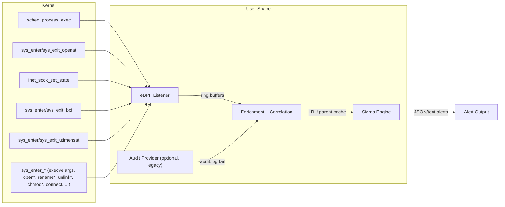

# Aurora Linux

Aurora Linux is a real-time Linux telemetry and detection agent.

It attaches eBPF programs to kernel tracepoints (process exec, file open, network state changes, bpf syscalls, and file timestamp changes) and natively synthesises auditd-compatible records (no auditd required), enriches the captured telemetry in user space, and evaluates each event against Sigma rules and IOC feeds to emit high-signal alerts in text or JSON. The goal is practical host detection with low overhead and clear, actionable output.



## What It Detects

Aurora Linux loads standard [Sigma rules](https://github.com/SigmaHQ/sigma) for Linux and matches them in real time against eBPF events and auditd logs:

### eBPF Events

| Event Type | Sysmon ID | eBPF Hook | Example Detections |
|---|---|---|---|
| **Process Creation** | 1 | `tracepoint/sched/sched_process_exec` | Reverse shells, base64 decode, webshell child processes, suspicious Java children |
| **File Create Time Change** | 2 | `tracepoint/syscalls/sys_{enter,exit}_utimensat` | Timestomping detection (attackers hiding file modification times) |
| **Network Connection** | 3 | `tracepoint/sock/inet_sock_set_state` | Bash reverse shells, malware callback ports, C2 on non-standard ports |
| **File Event** | 11 | `tracepoint/syscalls/sys_{enter,exit}_openat` | Cron persistence, sudoers modification, rootkit lock files, downloads to /tmp |
| **BPF Event** | 100 | `tracepoint/syscalls/sys_{enter,exit}_bpf` | Unauthorized BPF program loading, eBPF rootkit detection |

### Auditd-Compatible Events (native eBPF, default)

The [SigmaHQ linux/auditd rules](https://github.com/SigmaHQ/sigma/tree/master/rules/linux/auditd) match on raw auditd records and normally require auditd plus a hand-written `audit.rules` file. Aurora removes that dependency: in the default `--audit-mode ebpf` it synthesises the same records (`type`, `SYSCALL`, `exe`, `comm`, `key`, `a0`..`aN`, `name`, `nametype`, `euid`, ...) directly from eBPF, with the equivalent of the upstream audit watches built in. All 53 rules in `rules/linux/auditd` are triggered by the native records (see `lib/provider/ebpf/audit_rules_test.go`).

| auditd record | Produced from | Used by rules for |
|---|---|---|
| `EXECVE` (`a0`..`aN`, `argc`, `proctitle`) | argv captured in-kernel at `sched_process_exec` | ~30 command-line rules (`chmod 777`, `xclip`, `steghide`, `iptables`, `tcpdump`, `getcap -r /`, ...) |
| `SYSCALL` (`exe`, `comm`, `euid`, `key`) | exec, the `security_socket_connect`, `security_syslog` and module-load security hooks, and `sysinfo`/`personality`/`memfd_create`/`delete_module` tracepoints | web RCE (`euid=33`), suspicious exe folders, insmod, `split`, dmesg clearing, ASLR disabling, port scanning (`key=network_connect_4`), C2 tool execution (`key=susp_activity`) |
| `PATH` (`name`, `nametype`) | LSM security hooks (`security_file_open`, `security_path_{mknod,mkdir,unlink,rmdir,rename,link,symlink}`, `security_inode_setattr`, `security_file_truncate`), plus the exec'd binary | config tampering, `/etc/ld.so.preload`, sysrq, systemd unit creation, shell profile changes, BPFDoor artefacts, system-info discovery |
| `SERVICE_STOP`, `ADD_USER` | inferred from `systemctl stop/disable/mask`, `service ... stop`, `ufw disable`, `useradd` | firewall disabling, account creation |

**How file watches work.** Like auditd's `-w`, watches are attached to *inodes*, not path strings: the built-in watch list (`lib/provider/ebpf/audit_watch.go`) is expanded to the watched files and to the directories in which they can be created, and fentry programs on the kernel's LSM security hooks look the inode up in a BPF hash map (one lookup per open; the path is only resolved, in-kernel from the dentry/mount tree, on a hit). Because the kernel has already resolved the object, a watch cannot be bypassed by respelling the path (`//etc/ld.so.preload`, `/tmp/../etc/./…`), symlinks or hard links, `/proc/self/fd/N`, relative paths from a process that exits immediately, racing the path string from another thread, or 32-bit (`int 0x80`) syscalls (all verified live), nor by io_uring or `open_by_handle_at`, which reach the same hooks. Watches use `-p`-style permissions (tamper rules only see writes/attribute changes, discovery rules see reads). Writes and creations of exactly-named watched files (e.g. `ld.so.preload`) are additionally matched by name, which covers other mount namespaces (containers) whose inodes Aurora does not know.

The security-hook monitor needs BTF and fentry (x86-64 5.8+, arm64 6.0+); without `bpf_loop` (before 5.17) a legacy build with bounded path walks is used. Where fentry is unavailable each operation falls back to the syscall-tracepoint monitor (path-string matching, with the evasions above) and a warning is logged — see the kernel support matrix below.

Known differences from a real auditd:

- `TTY` / `USER_TTY` records (pam_tty_audit) have no eBPF equivalent; the PATH half of `lnx_auditd_keylogging_with_pam_d` works.
- `SERVICE_STOP` and `ADD_USER` are inferred from the command line instead of being logged by systemd/shadow-utils.
- Records come from security hooks / syscall entry, so there is no `exit` value; `success=yes` means the kernel's permission checks passed.
- `sysinfo`, `personality`, `memfd_create` and `delete_module` have no LSM hook; they are taken from the per-ABI syscall entry points (`__x64_sys_*`, `__ia32_[compat_]sys_*`, `__arm64_[compat_]sys_*`), so 32-bit callers are covered too (records carry `arch=40000003`/`40000028`).
- `Special File Creation via Mknod Syscall` fires for every FIFO `dockerd` creates for container stdio (as it would with auditd's `-S mknod`); expect it on Docker hosts.
- In other containers only writes/creations of exactly-named watched files are seen (no reads, no wildcard names such as `/etc/systemd/system/*.service`).
- A few upstream rules are inherently noisy on a real host: `System Shutdown/Reboot` fires on `runc init` run as root (it matches `init` plus any value equal to `0`), and `Use Of Hidden Paths Or Files` matches any watched `/.` path (e.g. `~/.bashrc` edits), exactly as with auditd.
- Aurora vendors a patched `go-sigma-rule-engine` (`third_party/`, an in-repo package). Upstream v0.3.0 could not load several rules (`|all` keyword maps, integer keywords, `selection_*` keyword lists, `---` inside a reference URL), disabled any `selection and not filter` rule when the event lacked a filter field, and compared values case-sensitively. Matching is now case-insensitive with ASCII-only folding (Sigma semantics without Unicode look-alike tricks).

### Optional: syslog / journald input

Off by default. Enable it to run the SigmaHQ `linux/builtin` rules (`syslog`, `auth`, `sshd`, `cron`, `vsftpd`, `clamav`, `guacamole` and the generic keyword rules for shell history, reverse shells, buffer overflows, ...):

```bash
sudo ./aurora --rules /path/to/sigma/rules/linux \
  --syslog-log /var/log/syslog --syslog-log /var/log/auth.log   # Debian/Ubuntu
# --syslog-log /var/log/messages --syslog-log /var/log/secure   # RHEL/Fedora
# --syslog-journal                                              # follow journald (needs journalctl)
```

Lines are parsed (RFC 3164, RFC 5424, optional `<PRI>`; bare text is kept) into `message`, `program`, `pid`, `hostname`, `facility`, `severity` and `raw`. Files are tailed from the end and survive log rotation. Rules that name a logsource service only see lines of that service (derived from the program: `sshd`, `cron`/`crontab`, `vsftpd`, `clamd`/`freshclam`, `guacd`, plus `syslog` for everything), so e.g. the cron rule that looks for `REPLACE` does not fire on unrelated daemons. Aurora's own log lines (program `aurora`) are skipped so alerts are never re-ingested. Without `--syslog-log`/`--syslog-journal` these service rules are reported as excluded at startup.

### Legacy: auditd log ingestion

Auditd support is optional and never the default. `--audit-mode auditd` tails `/var/log/audit/audit.log` (or `--audit-log` paths) instead of the eBPF records; `--audit-mode both` runs the two together. The same rules match, but auditd must be installed and configured with the audit rules documented in each Sigma rule. `--audit-mode off` disables auditd-compatible records altogether.

## Anti-Tamper Protection

`--tamper-protection detect` (default) | `enforce` | `off`

Aurora treats attempts to stop or blind it as events of their own. Alerts use the normal sinks (stdout, `--logfile`, TCP/UDP) with `alert_type=tamper`, `tamper_kind`, `tamper_severity` and the actor's pid/exe/command line.

| Threat | Detect (default) | Enforce (BPF-LSM) |
|---|---|---|
| Any signal to Aurora (`kill`, `tkill`/`tgkill` to any of its threads, process-group kills, `pidfd_send_signal`, `rt_sigqueueinfo`, SIGIO via `F_SETOWN`) | alert from the `security_task_kill` hook (every fatal or stopping signal is critical; SIGTERM from systemd: medium) | denied (`EPERM`), except from pid 1 and Aurora's own parent (systemd, container shim, supervisor) so `systemctl stop`/`docker stop` keep working |
| `ptrace`, `process_vm_readv/writev`, `/proc/PID/mem`, `pidfd_getfd` | alert | attach denied |
| Writes to Aurora's cgroup control files (`cgroup.kill`, `cgroup.freeze`, `memory.max`, ...) or `/proc/<aurora>/oom_score_adj`; nice/scheduler/ioprio changes | alert | denied (except pid 1 / parent) |
| Another process obtaining an fd to one of Aurora's own BPF programs, maps or links (the only way to detach, replace or alter them) | critical alert | denied; other software's BPF objects are not affected |
| Third-party tracing-class eBPF programs (kprobe, tracepoint, raw_tp, fentry/LSM, perf_event, struct_ops) loaded or attached | alert at load/attach, plus an inventory scan every 10 s (programs loaded while Aurora was restarting are reported too) | `BPF_PROG_LOAD`/`BPF_LINK_CREATE`/`BPF_RAW_TRACEPOINT_OPEN` of those types denied (pid 1 may still load) |
| Foreign eBPF programs calling `bpf_probe_write_user`, `bpf_override_return`, `bpf_send_signal` (can corrupt or kill monitoring) | critical alert with program id/name/tag | (see above) |
| Sensor silently blinded (program detached, hook altered) | **canary**: every 30 s a helper process exec's, creates a file, calls `sysinfo` and connects to `127.0.0.1:9`; a source that does not report is a critical alert; two misses in a row make Aurora exit non-zero so the service manager restarts it with fresh programs. A source only counts as silent once its reader has caught up past the helper's events; a reader still working through a backlog after 60 s raises a `pipeline-lag` alert (detections are delayed) instead of a restart. Rounds during which kernel events were dropped are inconclusive (a flood cannot force restart loops); helper events are recognised by pid only, so no other process can get its events hidden | same |
| Event flood that overflows the kernel ring buffers (a way to hide activity) | `event-loss` alert with the number of dropped events (checked every 5 s, reported at most every 30 s) | same |
| Aurora killed anyway (SIGKILL, OOM, crash) | next start raises `unclean-previous-exit`; for a SIGKILL it names the sender (pid, uid, comm), recorded in-kernel in a pinned BPF map under `/sys/fs/bpf/aurora` | same |
| Passive hardening | non-dumpable, `oom_score_adj=-900`, ignores SIGHUP/SIGUSR1/2/SIGTSTP-style signals, `Restart=always`, `OOMScoreAdjust` in the unit | same |

`enforce` needs `CONFIG_BPF_LSM` and `bpf` in the active LSM list (`cat /sys/kernel/security/lsm`; add `lsm=...,bpf` to the kernel command line). If unavailable Aurora logs a warning and keeps running in detect mode. **Enforce also blocks loading other tracing eBPF tools** (bpftrace, Falco, Tetragon, perf with BPF, ...) on the host while Aurora runs; inspecting or managing other software's BPF objects (`bpftool prog show`, `tc`, Cilium, systemd) keeps working: that is the point, but test it before rolling it out.

The detection hooks need BTF and fentry (see the kernel support matrix); where fentry is unavailable Aurora falls back to syscall tracepoints, which miss thread-id and process-group kills. Aurora finds its own pid as the kernel sees it, so all of this also works when it runs inside a pid namespace (container).

Limits (be aware): a root attacker who can still run `systemctl stop aurora` (signals from pid 1 are allowed so legitimate stops work), move Aurora into another cgroup, edit the unit or replace the binary is not prevented by these hooks; those are alerted on where visible (SIGTERM from pid 1, unclean exit marker) and can be tightened with `RefuseManualStop=yes` in `deploy/aurora.service`. The kernel's own BPF/LSM can only be fully protected with Secure Boot + kernel lockdown. In detect mode a `SIGKILL` can take Aurora down before its alert is flushed; the `unclean-previous-exit` alert on restart covers that.

## Requirements

- Linux kernel **5.8+** with BTF (`/sys/kernel/btf/vmlinux`)
- Root privileges (or `CAP_BPF` + `CAP_PERFMON` + `CAP_SYS_PTRACE`)
- Go 1.24+ (build only)
- clang + libbpf headers (BPF compilation only)

### Kernel support matrix

Aurora picks the best available implementation at start-up and logs which one is active:

| Kernel | File/network/syscall records | Tamper detection |
|---|---|---|
| x86-64 5.17+, arm64 6.0+ | security hooks (fentry on LSM hooks + per-ABI syscall entry points), full in-kernel path resolution | security hooks |
| x86-64 5.8–5.16 (BTF + fentry) | same hooks, "legacy" build without `bpf_loop`: paths deeper than 8 components are reported only when a watch matches the file or its directory | security hooks |
| fentry unavailable (e.g. arm64 < 6.0) | syscall tracepoints: path-string matching (respelled paths, symlinks, 32-bit and io_uring callers are not seen) | syscall tracepoints (thread-id and process-group kills not seen) |

Enforcement (`--tamper-protection enforce`) additionally needs BPF-LSM (`CONFIG_BPF_LSM` and `bpf` in the active LSM list).

## Quick Start

### Build

```bash
# On a Linux host with clang and bpftool installed:

# 1. Generate vmlinux.h (one-time)
bpftool btf dump file /sys/kernel/btf/vmlinux format c \
    > lib/provider/ebpf/bpf/vmlinux.h

# 2. Compile BPF C programs → Go bindings
go generate ./lib/provider/ebpf/

# 3. Build the binary
go build -o aurora ./cmd/aurora/

# 4. Build `aurora-util` (maintenance + debugging, optional)
go build -o aurora-util ./cmd/aurora-util/
```

Or use Make targets:

```bash
make build
make test
make vet
```

Linux note:
- `make build` auto-runs eBPF code generation when generated bindings are missing.
- Required tools on Linux: `bpftool` and `clang`.
- If you want VCS metadata in binaries, override `BUILDVCS=true`:
  - `make build BUILDVCS=true`

### Run

```bash
# Point at the Linux Sigma root directory (subfolders are loaded recursively)
sudo ./aurora --rules /path/to/sigma/rules/linux --json

# The linux/auditd rules work out of the box (native eBPF, no auditd needed).
# To use a real auditd log instead (legacy):
sudo ./aurora --rules /path/to/sigma/rules/linux --audit-mode auditd --audit-log /var/log/audit/audit.log --json
```

`--rules` is required. Aurora validates rule directories at startup and exits
with an actionable error if the paths are missing or invalid. Unsupported or
unmapped rules are skipped; startup only fails when zero rules are loadable.

For more readable terminal output, pretty-print JSON with `jq`:

```bash
sudo ./aurora --rules ~/sigma/rules/linux/ --json --min-level medium 2>&1 | jq .
```

### Deploy as a Service

```bash
sudo cp aurora /opt/aurora-linux/
sudo cp deploy/aurora.service /etc/systemd/system/
sudo systemctl daemon-reload
sudo systemctl enable aurora
sudo systemctl start aurora
```

Aurora automatically loads bundled IOC files from `resources/iocs/` next to the binary (for packaged installs: `/opt/aurora-linux/resources/iocs/`). Override with `--filename-iocs` and `--c2-iocs` when needed.

### Automated Install (Recommended)

```bash
# From a source checkout:
sudo ./scripts/install-service.sh \
  --aurora-binary ./aurora \
  --aurora-util-binary ./aurora-util

# From an extracted release package under /opt/aurora-linux:
sudo /opt/aurora-linux/scripts/install-service.sh
```

Supported distro families:
- Ubuntu/Debian
- RHEL/Fedora
- Arch

The installer:
- installs distro dependencies (`systemd`, `cron/cronie`, `curl`, `tar`, certificates)
- installs binaries and service files under `/opt/aurora-linux`
- installs bundled IOC files under `/opt/aurora-linux/resources/iocs`
- installs `/etc/systemd/system/aurora.service`
- updates Sigma signatures (unless `--skip-signature-update`)
- enables and starts `aurora`

## Aurora Utility (`aurora-util`)

`aurora-util` is the companion utility for both operations and debugging workflows.

### Maintenance and Upgrade

```bash
# Refresh Sigma Linux rules from SigmaHQ releases
sudo ./aurora-util update-signatures

# Upgrade aurora from Aurora-Linux GitHub releases
sudo ./aurora-util upgrade-aurora
```

### Debugging and Profiling

```bash
# Collect CPU (30s) + heap profiles from a running aurora instance
sudo ./aurora-util collect-profile --pprof-url http://127.0.0.1:6060 --output-dir /tmp/aurora-profiles
```

Enable pprof on the running agent (disabled by default):

```bash
sudo ./aurora --rules /path/to/sigma/rules/linux --json --pprof-listen 127.0.0.1:6060
```

### Scheduled Maintenance (Cron)

Install nightly maintenance (update signatures + restart service):

```bash
# From source checkout:
sudo ./scripts/install-maintenance-cron.sh --schedule "17 3 * * *"

# Or from installed package path:
sudo /opt/aurora-linux/scripts/install-maintenance-cron.sh --schedule "17 3 * * *"
```

Enable weekly binary upgrade in the same job:

```bash
sudo ./scripts/install-maintenance-cron.sh \
  --schedule "17 3 * * *" \
  --enable-binary-upgrade
```

Installed files:
- `/etc/cron.d/aurora-maintenance`
- `/opt/aurora-linux/bin/aurora-maintenance.sh`
- `/var/log/aurora-linux/maintenance.log`

### Config Templates

Templates shipped for operations customization:
- `/opt/aurora-linux/config/aurora.env.example`
- `/opt/aurora-linux/deploy/templates/rsyslog-aurora.conf.example`
- `/opt/aurora-linux/deploy/templates/aurora-maintenance.cron.example`

Use these to tune Aurora flags and set remote log forwarding.

## Example Output

When a Sigma rule matches, Aurora Linux emits a structured alert:

```json
{
  "level": "info",
  "message": "Sigma match",
  "sigma_rule": "e2072cab-8c9a-459b-b63c-40ae79e27031",
  "sigma_title": "Decode Base64 Encoded Text",
  "sigma_match_fields": ["CommandLine", "Image"],
  "sigma_match_details": {
    "CommandLine": ["base64 -d"],
    "Image": ["base64"]
  },
  "sigma_match_strings": ["'base64 -d' in CommandLine", "'base64' in Image"],
  "rule_id": "e2072cab-8c9a-459b-b63c-40ae79e27031",
  "rule_title": "Decode Base64 Encoded Text",
  "rule_level": "low",
  "rule_author": "Florian Roth",
  "rule_description": "Detects decoding with base64 utility",
  "rule_references": ["https://github.com/SigmaHQ/sigma"],
  "rule_path": "/path/to/sigma/rules/linux/process_creation/proc_creation_lnx_base64_decode.yml",
  "Image": "/usr/bin/base64",
  "CommandLine": "base64 -d /tmp/encoded_payload.b64",
  "ParentImage": "/bin/bash",
  "User": "root",
  "ProcessId": "8421",
  "timestamp": "2026-02-11T12:00:00.000000000Z"
}
```

## Configuration

| Flag | Default | Description |
|---|---|---|
| `-c, --config` | off | Load options from a YAML file (CLI flags override config values) |
| `--rules` | (required) | Sigma rule directories (repeatable, scanned recursively) |
| `--filename-iocs` | `resources/iocs/filename-iocs.txt` near binary | Filename IOC file (`REGEX;SCORE[;FALSE_POSITIVE_REGEX]`) |
| `--c2-iocs` | `resources/iocs/c2-iocs.txt` near binary | C2 IOC file (domains/IPs, one per line) |
| `-l, --logfile` | off | Output log file path |
| `--logfile-format` | `syslog` (or `json` when `--json`) | Log file format (`syslog` or `json`) |
| `--tcp-target` | off | Forward Sigma matches to TCP `host:port` |
| `--tcp-format` | `syslog` (or `json` when `--json`) | TCP output format (`syslog` or `json`) |
| `--udp-target` | off | Forward Sigma matches to UDP `host:port` |
| `--udp-format` | `syslog` (or `json` when `--json`) | UDP output format (`syslog` or `json`) |
| `--no-stdout` | off | Disable match output (Sigma + IOC) to stdout |
| `--process-exclude` | off | Exclude events with matching process fields (substring match) |
| `--trace` | off | Very-verbose event tracing (logs each observed eBPF event) |
| `--low-prio` | off | Lower process priority via `nice` |
| `--json` | off | JSON output format |
| `--ringbuf-size` | 2048 | Ring buffer size in pages (informational only; runtime tuning planned) |
| `--correlation-cache` | 16384 | Parent process LRU cache entries |
| `--throttle-rate` | 1.0 | Max Sigma matches per rule per second (`0` disables throttling) |
| `--throttle-burst` | 5 | Burst allowance per rule (used when throttling is enabled) |
| `--min-level` | info | Load only rules at or above this Sigma level (`info`, `low`, `medium`, `high`, `critical`) |
| `--stats-interval` | 60 | Stats logging interval (seconds, 0=off) |
| `--sigma-no-collapse-ws` | on | Disable Sigma whitespace collapsing during matching (default, reduces allocation churn; stricter matching) |
| `--syslog-log` | off | Optional syslog-style file to tail for the Sigma syslog/auth/sshd/cron/... rules (repeatable) |
| `--syslog-journal` | off | Optional: also follow the systemd journal as syslog input |
| `--tamper-protection` | `detect` | Anti-tamper: `detect`, `enforce` (BPF-LSM deny hooks) or `off` |
| `--strict-rules` | off | Fail at startup if any Sigma rule cannot be loaded or can never match on this host |
| `--audit-mode` | `ebpf` | Source of auditd-compatible records: `ebpf` (native, no auditd), `auditd` (tail audit log instead), `both`, `off` |
| `--audit-log` | off | Paths to auditd log files (repeatable; default `/var/log/audit/audit.log` in `--audit-mode auditd`/`both`). Given without `--audit-mode`, it implies `--audit-mode auditd` (backward compatible) |
| `--pprof-listen` | off | Enable local pprof endpoint on loopback `host:port` (for on-demand profiling) |
| `-v, --verbose` | off | Debug-level logging |

Operational notes:
- If `--logfile` is set and cannot be opened safely, startup fails.
- `--logfile-format`, `--tcp-format`, and `--udp-format` only accept `syslog` or `json`.
- `--no-stdout` requires at least one enabled sink (`--logfile`, `--tcp-target`, or `--udp-target`).
- IOC parsers skip malformed lines with warnings.
- If default IOC files are unavailable, Aurora logs a warning and continues without that IOC source.
- If `--filename-iocs` or `--c2-iocs` is explicitly set and cannot be read, startup fails.
- Text and JSON alert logs preserve reserved Sigma metadata fields and redact common secret/token patterns in logged fields.
- `--min-level medium` loads only `medium`, `high`, and `critical` rules during startup.
- `--sigma-no-collapse-ws` is enabled by default to reduce long-run memory/CPU churn from Sigma whitespace normalization.
- If you need legacy Sigma whitespace normalization semantics for compatibility testing, set `--sigma-no-collapse-ws=false`.
- `--pprof-listen` accepts loopback hosts only (`localhost`, `127.0.0.1`, `::1`).

Example YAML config:

```yaml
rules:
  - /opt/sigma/rules/linux
filename-iocs: /opt/aurora-linux/resources/iocs/filename-iocs.txt
c2-iocs: /opt/aurora-linux/resources/iocs/c2-iocs.txt
audit-mode: ebpf
logfile: /var/log/aurora-linux/aurora.log
logfile-format: syslog
tcp-target: myserver.local:514
tcp-format: json
sigma-no-collapse-ws: true
pprof-listen: 127.0.0.1:6060
```

## Architecture

Aurora Linux follows a **provider → distributor → consumer** pipeline:

- **Provider: eBPF** (`lib/provider/ebpf/`) -- eBPF programs attach to kernel tracepoints and deliver events via ring buffers. A userland listener reconstructs full fields from `/proc/PID/*`.
- **Provider: eBPF audit records** (`lib/provider/ebpf/audit*.go`, `bpf/audit_monitor.c`) -- syscall tracepoints that emit auditd-shaped `SYSCALL`/`EXECVE`/`PATH` records so the Sigma `linux/auditd` rules work without auditd.
- **Provider: Syslog** (`lib/provider/syslog/`, optional `--syslog-log` / `--syslog-journal`) -- tails syslog files and journald and feeds the Sigma `linux/builtin` service rules.
- **Provider: Audit** (`lib/provider/audit/`, legacy `--audit-mode auditd`) -- Reads Linux audit logs (e.g. `/var/log/audit/audit.log`), groups multi-line records by audit serial, and emits events with raw audit fields for direct SigmaHQ rule compatibility. Supports real-time tailing.
- **Distributor** (`lib/distributor/`) -- Applies enrichment functions (parent process correlation via LRU cache, UID→username resolution) and routes events to consumers.
- **Consumer** (`lib/consumer/sigma/`) -- Evaluates events against loaded Sigma rules using [go-sigma-rule-engine](https://github.com/markuskont/go-sigma-rule-engine). Includes per-rule throttling to suppress duplicate alerts.
- **Consumer** (`lib/consumer/ioc/`) -- Evaluates events against bundled IOC files (`filename-iocs.txt`, `c2-iocs.txt`) and emits IOC match alerts.

### Sigma Field Coverage

**eBPF provider** (Sysmon-compatible fields):

| Category | Sigma Fields Covered | Rule Coverage |
|---|---|---|
| `process_creation` | Image, CommandLine, ParentImage, ParentCommandLine, User, LogonId, CurrentDirectory | 119/119 rules (100%) |
| `file_event` | TargetFilename, Image, FileAction | 8/8 rules (100%) |
| `file_create_time` | TargetFilename, Image, NewAccessTime, NewModificationTime | timestomping detection |
| `network_connection` | Image, DestinationIp, DestinationPort, Initiated | 2/5 rules (40%) -- remaining 3 need DNS correlation |
| `bpf_event` | Image, User, ProcessId, BpfCommand, BpfProgramType, BpfProgramId, BpfProgramName, EventID | Sigma rules matching on `bpf()` syscall fields |

**Audit records** (eBPF-native or legacy audit log; raw audit fields):

| Category | Sigma Fields Covered |
|---|---|
| `linux/auditd` | type, syscall, key, exe, comm, a0-aN, name, nametype, cwd, proctitle, pid, ppid, uid, auid, SYSCALL, UID, AUID, and all other raw audit fields |

## Project Structure

```
aurora-linux/
├── cmd/aurora/                CLI entry point (cobra)
├── cmd/aurora-util/           Utility CLI for maintenance and debugging workflows
├── scripts/                   Install + maintenance automation
├── lib/
│   ├── provider/ebpf/         eBPF listener + BPF C programs
│   ├── provider/audit/        Auditd log provider (real-time + batch)
│   ├── provider/replay/       JSONL replay provider (for CI)
│   ├── distributor/           Event routing + enrichment
│   ├── enrichment/            DataFieldsMap, correlator cache
│   ├── consumer/sigma/        Sigma rule evaluation
│   ├── consumer/ioc/          IOC evaluation (filename + C2)
│   └── logging/               JSON + text formatters
├── resources/iocs/            Bundled IOC files for runtime matching
├── resources/log-sources/     Legacy Sigma category→provider mapping files (not consumed by runtime)
├── deploy/                    systemd + template configs
└── docs/                      Design plan + developer guide
```

## Documentation

- **[Developer Guide](docs/DEVELOPER.md)** -- Codebase walkthrough, design decisions, what works, what needs work. Start here if you're contributing.
- **[Technical Design Plan](docs/plan_aurora_linux_ebpf_sigma.md)** -- Full technical specification with BPF struct definitions, field mapping tables, worked examples, and performance analysis.

## Development

```bash
# Build (compiles on macOS via stubs, runs on Linux only)
go build ./...

# Run tests (field mapping, enrichment, correlator)
go test ./...

# Lint
go vet ./...
```

## License

GPL-3.0. See [LICENSE](LICENSE).
